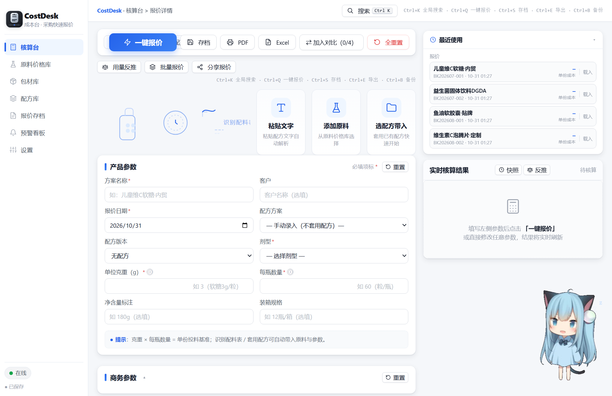
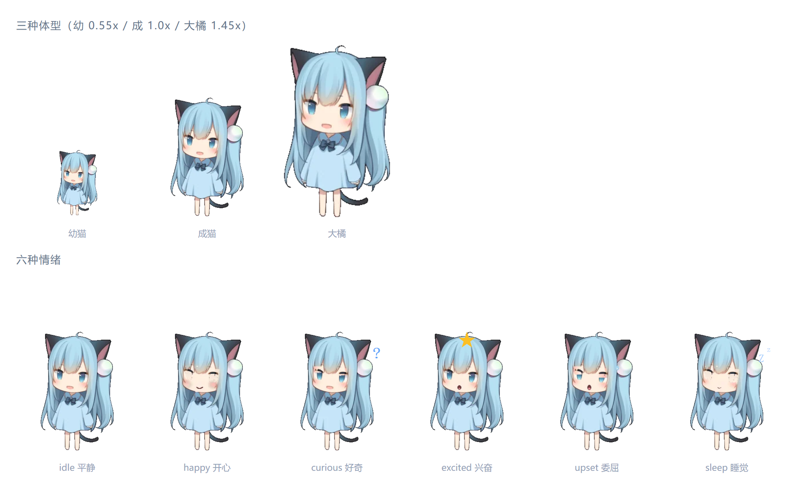

<div align="center">

# 成本台 CostDesk

**保健品 OEM 报价工作台 · 把报价从个人手艺，变成可审计的模型**

单文件离线运行 · 零外部依赖 · 断网可用 · 821 项自动化测试

</div>



---

## 这是什么

保健品 OEM/ODM 代工报价，长期依赖 Excel。真正的痛点不是慢，是**算得对不对，没人知道**。

CostDesk 把整条成本核算链拆成可审计的模型：

| 痛点 | 具体表现 |
|---|---|
| **口径不统一** | 原料损耗、包材损耗、生产损耗，三个人三种算法；开模费有的按单分摊、有的不算 |
| **不可审计** | 公式散在几十个单元格里，客户问「这个价怎么来的」，答不上来 |
| **经验绑个人** | 老业务员一走，报价逻辑就断了，新人接手要重新摸 |

核心不是界面，是**一个可审计的成本模型**。

---

## 核心能力

### 全链路成本核算

```
原料成本 = Σ(含量% × 单份克重 × 单价/1000) × (1 + 原料损耗%)
包材成本 = Σ[(单价×(1+包材损耗) + 印刷费 + 开模费÷MOQ) × 用量] × (1 + 生产损耗%)
成本合计 = 原料 + 包材 + 加工 + 检测 + 运费 + 管理费 + 定制溢价
报价     = 成本 × (1 + 目标利润率)，支持含税 / 不含税双口径
```

**三层损耗率独立建模** —— 这是它和普通 Excel 报价表最大的区别。

### 三档报价与阶梯重算

保本价 / 目标价 / 报价价；开模费按订单量分摊，MOQ 变化自动重算；低于利润率警戒线标红。

### 三种录入方式

| 方式 | 说明 |
|---|---|
| 手动录入 | 原料库 / 包材库 / 配方库，一次录入长期复用 |
| **AI 识别** | 拍照或截图报价单 → 视觉模型提取 → 自动填充 |
| **本地解析** | 粘贴文本报价单 / 配方，规则引擎解析（不联网、不需要 API） |

### 报价存档与复用

历史报价可存档、可回溯、可一键载入修改。

### 桌宠

204×320 立绘贴图，WebP base64 内联，7 层表情 × 3 体型，带养成系统。

<div align="center">

</div>

---

## 工程质量

| 指标 | 数据 |
|---|---|
| 成品体积 | **555 KB 单文件** |
| 外部依赖 | **0**（零外链、断网可用） |
| 源码规模 | 14 个源文件 / 12 个 JS 模块 |
| 自动化测试 | **821 项 / 10 套件 / 全绿** |
| 构建 | 确定性合并，重复构建**字节级一致**（sha1 基线可校验） |
| 版本 | V7 → V14，8 个大版本 |

### 构建顺序

```
calc → parse → classify → store
     → ui-common
     → ui-recognize → ui-calc → ui-libs → ui-quotes
     → petframes → ui-pet
     → app
```

模块间只通过 `global.WB` 命名空间通信，下层不依赖上层——为了最终能合并成单文件。

---

## 快速开始

```bash
# 只想用：双击 CostDesk.html

# 改代码
cd src
node build.js        # 源码 → 单文件 HTML

# 跑测试（需要 jsdom）
cd src && npm install
node run-all.js      # 821 项
```

**注意**：测试加载的是构建产物，改完源码必须先 `build` 再跑测试。

---

## 项目结构

```
CostDesk-源码/
├─ CostDesk.html          成品，双击即用
├─ 00-工程说明.md
├─ src/                   源码（唯一真源）
│  ├─ calc.js             核算引擎（纯函数，可单元测试）
│  ├─ parse.js            本地解析引擎
│  ├─ classify.js         原料分类规则库 + AI 桥
│  ├─ store.js            数据层（localStorage）
│  ├─ ui-*.js             五类业务视图
│  ├─ petframes.js        桌宠贴图（WebP base64）
│  ├─ ui-pet.js           桌宠渲染与养成
│  ├─ app.js              装配层
│  ├─ build.js            构建脚本
│  └─ test-*.js           10 套测试（821 项）
├─ dev/                   诊断与渲染工具
├─ docs/                  文档（含 V7~V14 版本明细）
└─ screenshots/
```

---

## 三个关键设计决策

**① 为什么是单文件？**
工厂的电脑装不了 Node、装不了环境，甚至没网。要能在任何一台 Windows 上双击就跑，只有单文件这条路。代价是源码拆 12 个模块，靠构建脚本合并。

**② 为什么 `calc.js` 是纯函数？**
核算逻辑必须可测试、可审计。所以它不碰 DOM、不碰存储——输入对象、输出对象，单元测试可以直接断言。

**③ 为什么贴图要转 WebP？**
15 张 204×320 PNG 共 620 KB，base64 后约 830 KB。转 WebP(q82) 后总共 67.8 KB（体积降到 11%），base64 后仅 90 KB——**约束没变，只是换了编码方式**。

---

## 已知限制

- **数据需要积累**：这是「越用越好用」型工具，第一周要录 30 个常用原料，之后就不用再录了
- **单机单用户**：数据存在浏览器 localStorage，不跨设备同步
- **手机端不适配**：为桌面场景设计
- AI 识别是可选增强，不配置 API 也能用本地解析

---

## License

MIT
